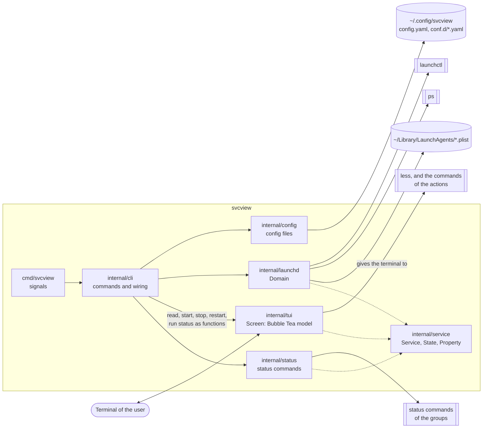
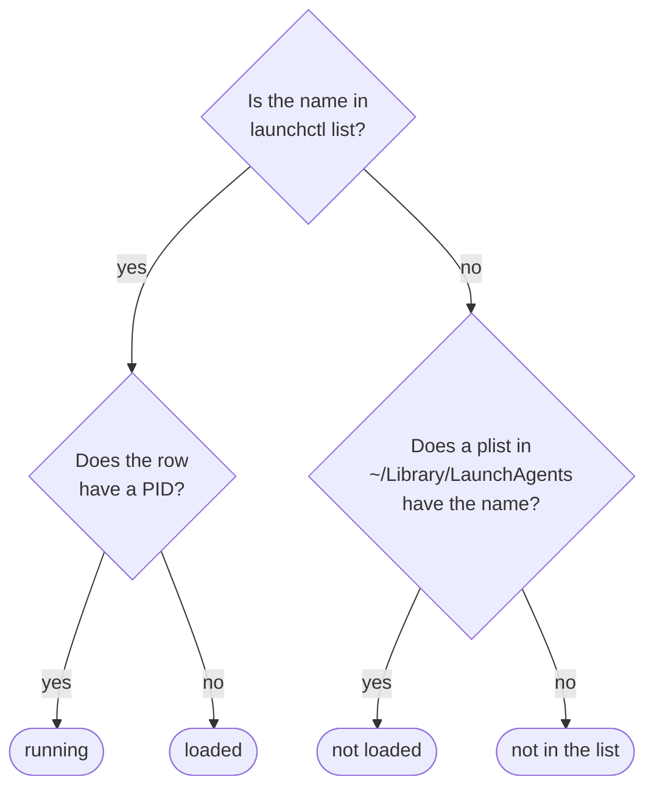
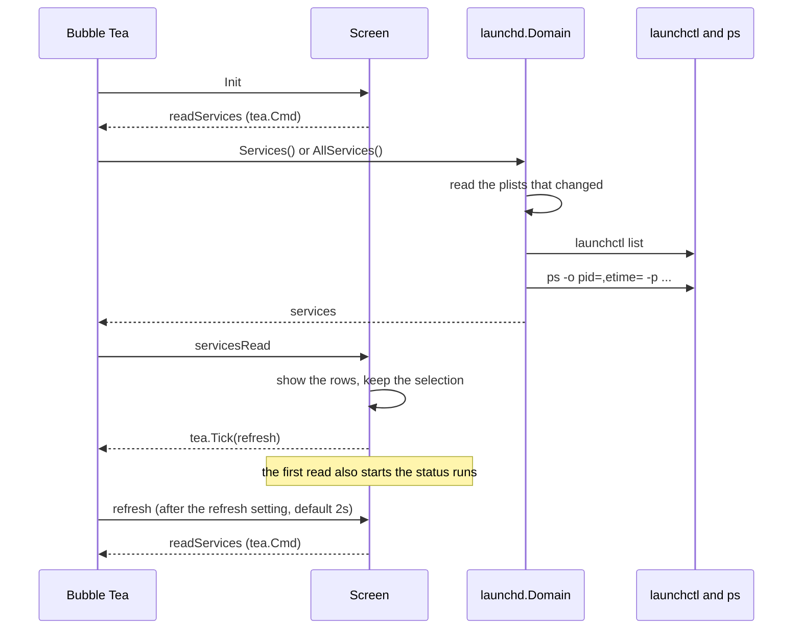
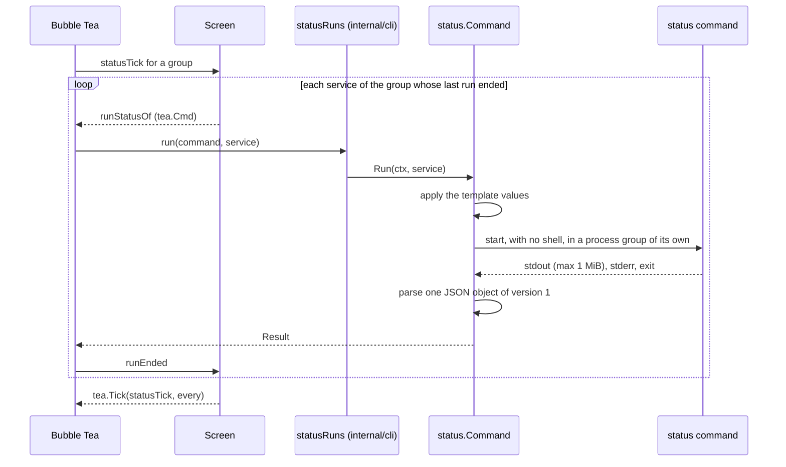
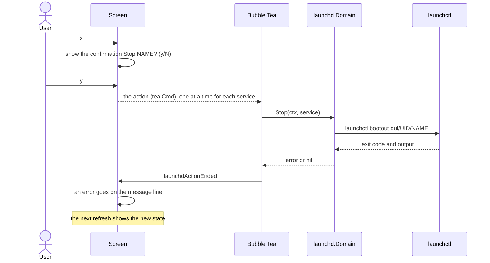
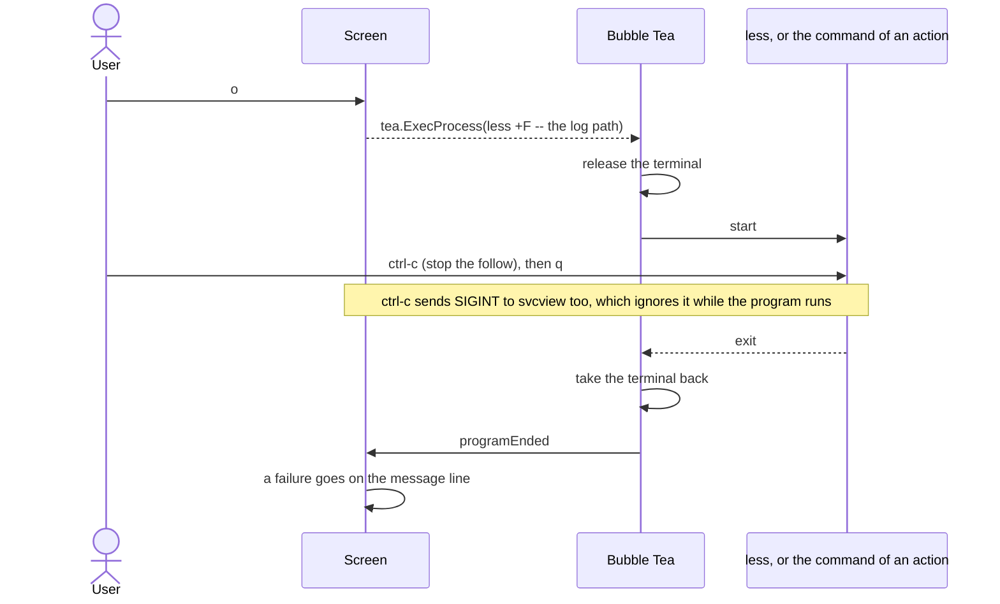
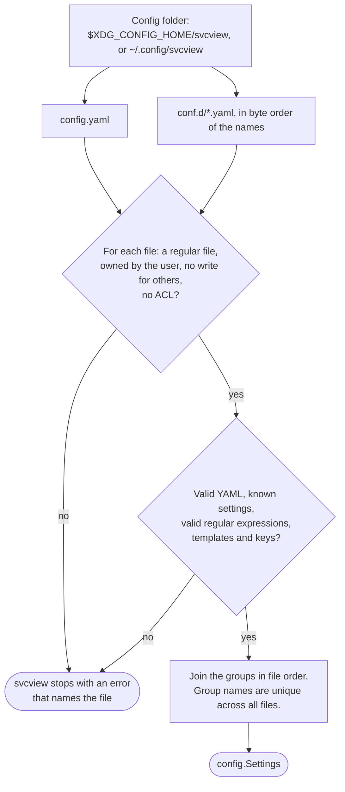

# The Design of svcview

This document describes how svcview works inside: its parts, what it reads from launchd, and what happens on each
refresh, status run, and key. It is for a developer who changes svcview. `docs/cli.md` describes the behaviour for a
user, and `docs/proposal-launchd-tui.md` gives the reasons for the design.

## The Parts

svcview is one Go program. It talks to launchd only through the `launchctl` and `ps` programs and the plist files.
It does not use the XPC API of launchd, so the code builds on Linux, and the e2e tests replace `launchctl` and `ps`
with fake scripts.

| Package | Job |
| --- | --- |
| `cmd/svcview` | The `main` package. It ends the context of svcview at `SIGHUP` and `SIGTERM`, and runs the root command. |
| `internal/cli` | The commands. With no command, in a terminal, the root command reads the config, makes a `launchd.Domain`, and opens the screen. It also has `svcview status`, `version`, and `update`. |
| `internal/tui` | `Screen`, the Bubble Tea model, and its views. It does not import `internal/launchd`: `internal/cli` gives it the reads and the actions as functions. |
| `internal/launchd` | `Domain`. It runs `launchctl` and `ps`, reads the plists, and returns `service.Service` values. It is the only package that knows launchd. |
| `internal/status` | Runs a status command for one service, and parses its JSON output. |
| `internal/config` | Reads and checks `config.yaml` and `conf.d/`. |
| `internal/service` | The types `Service`, `State`, `LastExit`, and `Property`, which the other packages share. |
| `internal/terminal` | Replaces the control characters of a text from outside, so that a name or an output cannot change the terminal. |

The rule that only `internal/launchd` knows launchd keeps the other packages free of launchd words. A later version
can add a second service manager beside it.

## What svcview Reads From launchd

`Domain` joins three sources into one list of services:

| Source | What svcview gets | When |
| --- | --- | --- |
| `launchctl list` | The name, the PID, and the last exit of each service that launchd has in `gui/<uid>` | Each read |
| `~/Library/LaunchAgents/*.plist` | The `Label`, the environment, the log paths, and the other properties of each plist | Each read, but svcview parses a plist again only when its modification time changes |
| `ps -o pid=,etime= -p <PID>,<PID>` | The uptime of each running service | Each read, one call for all PIDs |

svcview checks the header line of `launchctl list`. When the header is not `PID`, `Status`, `Label`, svcview shows an
error and reads no row. It does not parse `launchctl print`, because the man page says that its output is not an
API.

The state of a service comes from the two first sources:

`Domain.Services` gives the services that have a plist. `Domain.AllServices` also gives each name of
`launchctl list` that has no plist, for `--all` and the key `a`. A service with no plist has no environment, no log
paths, and no properties.

## The Refresh Cycle

Bubble Tea calls `Screen.Update` for each message, and runs each `tea.Cmd` in a goroutine of its own. `Update` does
no I/O: each read, status run, and action is a `tea.Cmd` that sends a message when it ends.

`Domain` must not read from two goroutines at the same time, so the screen runs one read at a time:

- The next read starts one `refresh` after the last read ends. So two reads never overlap, also when `launchctl`
  is slow.
- `a` starts a read at once when no read runs. When a read runs, its result has the other value of `all`, so the
  screen drops it and starts the read that `a` asks for.
- A count of the reads that started marks each `refresh` tick. A tick from an earlier read does nothing, so `a`
  starts no second cycle.

## The Status Runs

A group with a `status` setting gets one status run for each of its services every `status.every`. The runs start
after the first read ends.

- **Templates:** `{{.Name}}`, `{{.Env.X}}`, `{{.StdoutPath}}`, `{{.StderrPath}}` and `{{.PlistPath}}` come from the
  plist. A value that the plist does not have is a failure, for example `the plist has no WORKER_STATUS_FILE`, and
  svcview runs no command.
- **Timeout:** at `status.timeout`, svcview kills the process group of the run, so a child of the command also ends.
- **Failures:** an exit code other than 0, a timeout, and an output that is not valid each give a `Failure`, which
  the row shows as `status error`, `status timeout`, or `status invalid`.
- **Stale:** the screen compares `at` of the output with `status.stale_after` when it draws, so a status gets stale
  with no new run.
- **Quit:** `statusRuns.stop` ends the context of the runs and waits until each run ends, so no command outlives
  svcview.

## The Actions on launchd

`s`, `x` and `r` call the functions that `internal/cli` gives to the screen. Each function runs one `launchctl`
command through `Domain`:

| Key | State of the service | Command |
| --- | --- | --- |
| `s` | `not loaded` | `launchctl bootstrap gui/<uid> <plist path>` |
| `s` | `loaded` | `launchctl kickstart gui/<uid>/<name>` |
| `x` | `loaded` or `running` | `launchctl bootout gui/<uid>/<name>` |
| `r` | `loaded` or `running` | `launchctl kickstart -k gui/<uid>/<name>` |

The confirmation keeps the service that was selected when the question showed, and the action that the key asked
for. `y` runs that action, and each other key answers no. A `launchctl` command that does not end in 30 s is killed
with its process group.

## Giving the Terminal to a Program

`o` opens the log in `less +F`, and the key of an action runs the command of the action. Both go through
`Screen.giveTerminalTo`, which uses `tea.ExecProcess`: Bubble Tea gives the terminal to the program, and draws the
screen again when the program ends.

While the program has the terminal, `ctrl-c` sends `SIGINT` to each process in the foreground process group of the
terminal: to the program, and to svcview too. These rules keep svcview open:

| Where | Rule |
| --- | --- |
| `cmd/svcview` | The context of svcview ends only at `SIGHUP` and `SIGTERM`. |
| `showScreen` in `internal/cli` | It catches `SIGINT` while the screen runs. Bubble Tea ends the screen at `SIGINT` only while no program has the terminal. |
| `endAtInterrupt` in `internal/cli` | Each subcommand, for example `svcview status`, still ends at `SIGINT`. |

## The Config

svcview reads the config once, before it opens the screen. A change takes effect at the next start.

A config file holds commands that svcview runs, so svcview refuses a file that another user can write.
`Settings.GroupOf` puts a service into the first group whose `match` matches its name, and into `Other` when no
group matches.

## svcview status

`svcview status <name>` uses the same parts with no screen. It reads the config and `Domain.Services`, finds the
group of the service, runs its status command one time, and prints the template values, the command line, the
output, and the result. It exits with 1 when the result is not valid.
