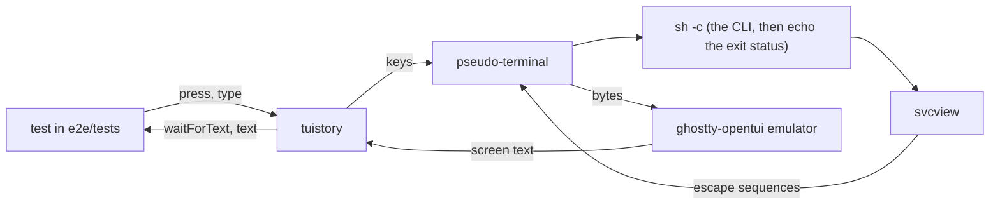
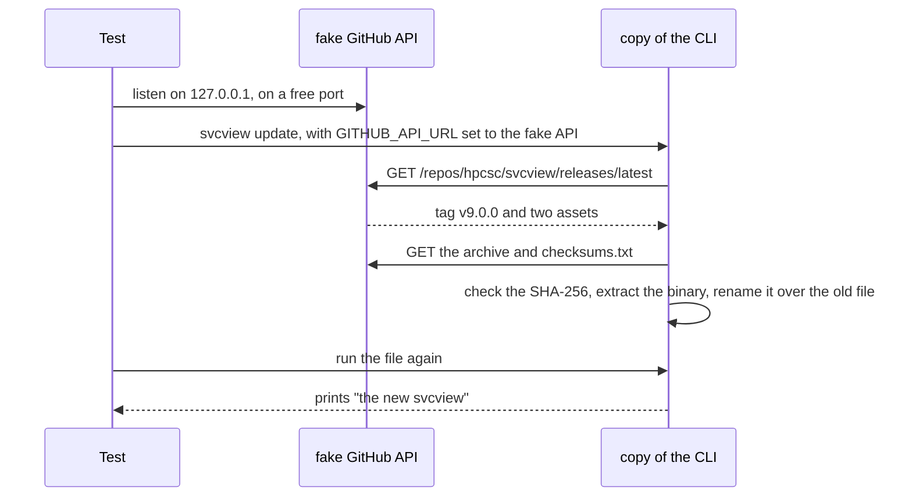
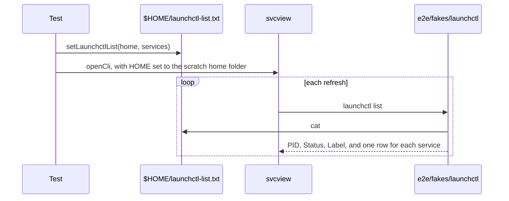
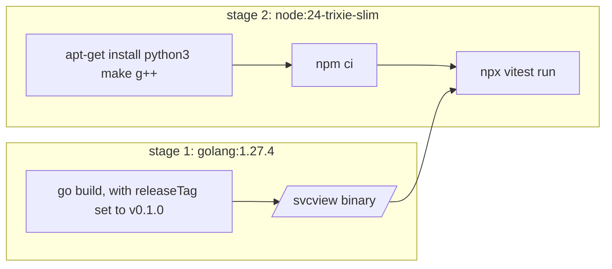

# How the end-to-end tests work

The end-to-end tests run the svcview binary in a terminal, send keys to it, and read the
screen. They find faults that the Go tests cannot find: the real terminal output, files on disk, and
exit codes.

The tests are in `e2e/`. `e2e/testUtils.ts` has the helpers, and `e2e/tests/` has the tests.

## Parts

| Part | Job |
| --- | --- |
| vitest | Finds and runs the tests in `e2e/tests/`. |
| tuistory | Starts a program in a pseudo-terminal, sends keys to it, and gives its screen as text. |
| node-pty | Makes the pseudo-terminal for tuistory. |
| ghostty-opentui | The terminal emulator in tuistory. It turns the output of the CLI into a screen of text. |
| `testUtils.ts` | Makes throwaway folders, starts the CLI, and deletes the folders after each test. |



## Plain commands and screen tests

Two helpers start the CLI:

| Helper | Use for | How it works |
| --- | --- | --- |
| `runCli(cwd, args, env)` | Commands that print and stop, such as `version` and `update` | Starts the CLI as a child process with pipes. It gives stdout, stderr and the exit status. |
| `openCli(cwd, args, env)` | The screen, and commands that ask for input | Starts `sh -c 'printf "\033[20l"; unset XDG_CONFIG_HOME; <env> <cli> <args>; echo "EXIT:$?"'` in a pseudo-terminal. When the CLI stops, the shell writes its exit status on the screen, so a test can wait for `EXIT:0`. [New line mode](#new-line-mode) tells why the command starts with `printf`, and [the config file](#the-config-file) tells why it unsets `XDG_CONFIG_HOME`. |

`runCli` does not block. The update tests run a fake server in the test process, and that server must
answer while the CLI waits for it.

svcview with no command opens the screen only when stdin and stdout are both terminals. `runCli` uses pipes,
so svcview prints the help there. `openCli` gives it a pseudo-terminal, so it opens the screen.

## New line mode

The emulator in tuistory starts in new line mode. In that mode, a line feed moves the cursor to the next
line and also back to column 1. A real terminal starts with the mode off, so a line feed keeps the column.

A full screen program, such as a Bubble Tea one, draws only the cells that change. It moves the cursor
down with a line feed and expects the column to stay the same. In new line mode, the text then goes to the
wrong column.

So `openCli` writes `\e[20l`, which turns new line mode off, before it starts the CLI.

## The update tests

The update tests start a fake GitHub API in the test process and point the CLI at it with
`GITHUB_API_URL`. The fake release holds an archive for the platform of the test and a `checksums.txt`.
The "new binary" in the archive is a shell script, so the test can see that the update replaced the file.



Each update test runs a copy of the CLI in its own folder. The update replaces that copy, so the other
tests keep the original binary.

## The screen tests

The screen tests start svcview with no command in the pseudo-terminal of `openCli`. svcview lists the plists in
`$HOME/Library/LaunchAgents`, so each test gives it a scratch home folder through `HOME`:

| Helper | Job |
| --- | --- |
| `homeWithPlists(names)` | Makes a scratch home folder. For each name, it writes `<name>.plist` to `Library/LaunchAgents`, with the name as its `Label`. It also writes an output of `launchctl list` that shows no names, so each service is `not loaded`. |
| `addPlist(home, name)` | Writes one more plist to a home folder, for example while the screen is open. |
| `setLaunchctlList(home, services)` | Writes the output of `launchctl list` that the fake `launchctl` prints for this home folder. A service with a `pid` is `running`, and a service with no `pid` is `loaded`. The `status` of a service is its `Status` column, 0 when it has none, and a negative `status` is a signal. A test can call it again while the screen is open. |
| `setLaunchctlOutput(home, output)` | Writes any text as the output of `launchctl list`, for example a header line that svcview does not know. |

```ts
const session = await openCli(scratchDir(), [], { HOME: homeWithPlists(['com.example.worker']) })
await session.waitForText('com.example.worker')
await session.press('q')
await session.waitForText('EXIT:0')
```

The header shows the domain `gui/<uid>` of the user that runs the tests. In Docker the tests run as root, so the
domain is `gui/0`. The tests compare it with `process.getuid()`.

### The fake launchctl

svcview runs `launchctl list` at each refresh to get the state of each service. The Docker image has no `launchctl`,
and a test on a Mac must not read the real services. So `openCli` puts `e2e/fakes` first on `PATH`, and svcview runs
the fake `launchctl` in that folder:



- For `list`, the fake prints the file `launchctl-list.txt` in the home folder. svcview gives the fake its own `HOME`.
- For any other arguments, the fake writes an error to stderr and exits with 64.
- `setLaunchctlList` writes the file to a new name and renames it over the old file. So the fake never prints half
  of the file while the screen is open.
- The fake must stay executable in git (mode `100755`): the Docker image copies the mode with the file.

### The fake ps

svcview runs `ps -o pid=,etime= -p <PID>,<PID>` at each refresh to get the uptime of each `running` service. The
Docker image has no `ps`, and the real `ps` on a Mac knows nothing of the PIDs of the fake `launchctl`. So
`e2e/fakes` also holds a fake `ps`:

- For `-o pid=,etime= -p <PID>,<PID>`, the fake prints one line for each PID that it gets, with the elapsed time
  `03:12:07`. The detail pane shows it as `up 3h12m`.
- For any other arguments, the fake writes an error to stderr and exits with 64.
- The fake must stay executable in git (mode `100755`), as the fake `launchctl` must.

A test that passes its own `PATH` to `openCli` replaces the `PATH` with the fakes. Keep `e2e/fakes` first in it.

### The config file

Before svcview opens the screen, it reads `config.yaml` in `$XDG_CONFIG_HOME/svcview/`, or in
`$HOME/.config/svcview/` when `XDG_CONFIG_HOME` is not set, and then each `*.yaml` file in `conf.d/` of that folder.
On a Mac whose user sets `XDG_CONFIG_HOME`, a test would then read the real config files of that user. So the tests
start svcview with no `XDG_CONFIG_HOME` of the test run:

- `openCli` unsets `XDG_CONFIG_HOME` before it sets the `env` of the test.
- `runCli` gives svcview the environment of the test run without `XDG_CONFIG_HOME`.

A test that puts `XDG_CONFIG_HOME` in its `env` gives svcview that value.

| Helper | Job |
| --- | --- |
| `writeConfig(configFolder, content, mode)` | Makes the config folder, writes `content` to `config.yaml` in it, and gives the file the mode `mode`, `0o644` when the test gives none. It returns the path of the file, which each error of the config file names. |
| `writeConfD(configFolder, name, content, mode)` | Makes `conf.d` in the config folder, writes `content` to the file `name` in it, and gives the file the mode `mode`, `0o644` when the test gives none. It returns the path of the file, which each error of that file names. |

```ts
const home = homeWithPlists(['com.example.worker'])
writeConfig(join(home, '.config', 'svcview'), 'refresh: 1m\n')
const session = await openCli(scratchDir(), [], { HOME: home })
```

svcview refuses a config file that its group or other users can write, so `writeConfig` and `writeConfD` set the
mode with `chmod` and do not depend on the umask. In Docker the tests run as root, and root owns the file that a test
writes, so svcview accepts the owner.

The terminal has 160 columns, and an error that names a long path continues on the next line. A test that checks
the error removes the line breaks from the screen text first.

svcview also refuses a `config.yaml` that has an ACL. The test of this refusal gives the file an ACL entry with
`/bin/chmod +a`, and removes the ACL with `/bin/chmod -N`. Only macOS has these ACLs and these options of `chmod`.
The Docker image runs Linux, so the test skips there, and only `task test:e2e:local` on a Mac runs it. The test
runs `/bin/chmod` and not `chmod`, because a Mac can find the GNU `chmod` of Homebrew first on `PATH`, and the GNU
`chmod` has no `+a` and no `-N`.

## Where the tests run

| Command | Where | What it needs |
| --- | --- | --- |
| `task test:e2e` | Docker | Docker |
| `task test:e2e:local` | This machine | Node |

The test of a `config.yaml` with an ACL runs only with `task test:e2e:local` on a Mac. In Docker it skips, because
Linux has no ACLs of macOS ([the config file](#the-config-file)).

Both ways build the CLI with the tag `v0.1.0`. They set
two environment variables for the tests: `EXECUTABLE`, the path of the binary, and `BUILD_TAG`, the tag.
The `version` and `update` tests compare the output of the CLI with `BUILD_TAG`.

The Docker image has two stages:



`python3`, `make` and `g++` let npm build node-pty when no prebuilt node-pty fits the platform. The image
runs `npm ci` when `e2e/package-lock.json` is in the repository, and `npm install` when it is not. Commit
the lock file, so every run installs the same packages.

The job `e2e` of `.github/workflows/ci.yml` runs `task test:e2e` on each push, next to the job `test` of the
repo.

## How to write a new test

1. Make a folder with `scratchDir()`.
2. Start the CLI with `openCli(dir)`, or with `runCli(dir, args)` when the command prints and stops.
3. Wait for text that shows that the screen is ready, for example the first line that the command prints.
4. Send keys with `press`. Use `type` for text and for capital letters, because the key names in tuistory
   have lower case letters only.
5. Wait for the text that proves the result. Then check the rest of the screen with `expect`.

Keep these rules:

- **Wait for the text that you check, not for a title:** a program that loads in the background can show a
  title before its content.
- **Give each test its own folder:** `scratchDir()` makes the folder, and `onTestFinished` deletes it.
- **Do not change the terminal size:** `openCli` uses 160 columns and 40 rows, and the tests expect text
  that fits that size.
