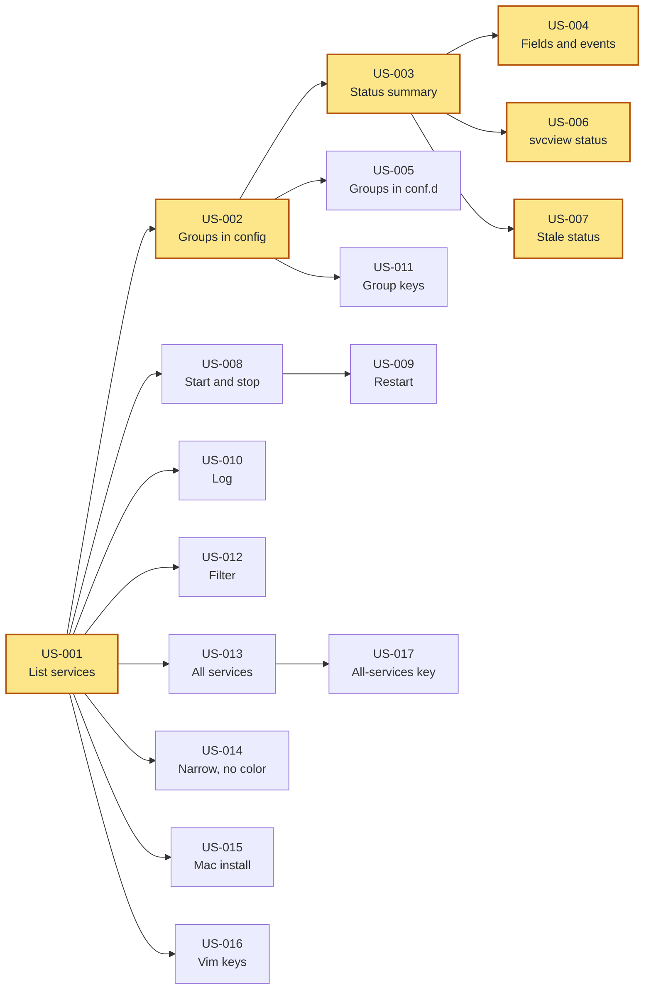

# svcview: A launchd TUI

**Proposal:** `docs/proposal-launchd-tui.md`

## Overview

svcview is a terminal UI for the launchd services of the user on macOS. launchd knows if the process of a service
is alive, but it does not know what the program in that process does. When `launchctl list` shows a PID for a
worker, the worker can be busy, idle, or paused, and a person must read its log to see which.

svcview shows the data of launchd for each service. It also runs a status command from its config, and shows the
status that each service reports about itself. It starts, stops, and restarts a service, and opens its log.

The stories use the words of the proposal: service, name, state, last exit, uptime, status, group, key, setting,
and property. [Words in This Document](../docs/proposal-launchd-tui.md#words-in-this-document) gives the meaning of
each word.

## Goals

The goals are G1 to G5 in [the proposal](../docs/proposal-launchd-tui.md#goals): the list of services with their
launchd data, the status that each service reports, the actions on a service, groups that another program adds with
one file, and the install on a Mac.

## Delivery Order

Everything blocks on US-001: until svcview lists the services, no other story has a screen to act on. When it
lands, eight stories can start at the same time.

The shaded chain is the critical path, at four deep: the list, then the groups, then the status summary, and then
any of US-004, US-006, and US-007. Start US-002 and US-003 first after US-001, because six stories wait on US-002.
No other chain is longer than three.

## User Stories

### US-001: See the launchd services in a list

**Goals:** G1

**Description:** As a developer on a Mac, I want one screen that lists my launchd services with the state, the PID,
and the last exit of each one, so that I see which services run with no `launchctl list` and no search in
`~/Library/LaunchAgents`.

**Acceptance Criteria:**

- [ ] `svcview` with no command, in a terminal, opens the screen. When stdin or stdout is not a terminal, it prints
      the help and reads no input.
- [ ] The list shows one row for each service that has a plist in `~/Library/LaunchAgents`, in the group `Other`,
      sorted by name. Each row starts with the glyph of the state: a green `●` for `running`, a yellow `◐` for
      `loaded`, and a gray `○` for `not loaded`. A name that is too long for the list ends with `…`.
- [ ] The header shows the domain, for example `gui/501`, and the number of services in each state, for example
      `● 2 running   ◐ 0 loaded   ○ 1 not loaded`.
- [ ] The title of the detail pane shows the full name of the selected service. The pane shows the state, the PID,
      the uptime, and the last exit. When a signal ended the last run, the pane shows the signal, not an exit code.
- [ ] A last exit other than 0 makes the glyph in the list and the `last exit` value red.
- [ ] Every 2 s, the screen shows each change with no key press: a service that starts, stops, or exits, and a plist
      that the user adds, removes, or changes.
- [ ] `↑` and `↓` select a service. The selected row has a `▌` in the accent color and a background color. `?`
      shows all keys, and `q` quits.
- [ ] When the header line of `launchctl list` is not `PID`, `Status`, `Label`, the screen shows an error and no
      rows.

**Context:** launchd keeps no history, so the last exit is the only sign of a crash. launchd starts a service with
`KeepAlive` again after each crash, so the service shows `running` with a new PID each time. The red glyph shows
this service in the list. [Data From launchd](../docs/proposal-launchd-tui.md#data-from-launchd) in the proposal
gives the source of each value and the rule for each state.

### US-002: Put the services in groups with a config file

**Goals:** G1

**Description:** As a developer with many services, I want to put my services in named groups with short names, so
that related services stay together in the list and each row is easy to read.

**Acceptance Criteria:**

- [ ] svcview reads `config.yaml` in `$XDG_CONFIG_HOME/svcview/`, or in `~/.config/svcview/` when `XDG_CONFIG_HOME`
      is not set. With no config file, the screen is as in US-001.
- [ ] Each entry in `groups` has a `name` and a `match`, which is a Go regular expression. The list shows the groups
      in the order of the config, and then the group `Other` with each service that no group matches. A service
      that matches two groups is in the first one. In each group, the services are sorted by name.
- [ ] A row in a group shows the short name: the part of the name after the text that `match` matched, when the
      match starts at the first character. For example, `^com\.example\.worker\.` gives `01` for
      `com.example.worker.01`. In all other cases, and in the group `Other`, the row shows the full name.
- [ ] `refresh` sets the time between two refreshes of the screen. The default is `2s`.
- [ ] An unknown setting, an invalid regular expression, or two groups with the same name stop svcview at start.
      The error names the file and the group.
- [ ] svcview refuses to start when another user can write the config file. The error names the file.
- [ ] `docs/cli.md` describes the config file, its settings, and the rules that put a service in a group.

**Context:** From US-003 on, the config holds commands that svcview runs. Thus a config file that another user can
write lets that user run commands as the user of svcview. The title of the detail pane always shows the full name.

**Depends on:** US-001

### US-003: See the status that each service reports

**Goals:** G2

**Description:** As a developer who runs a worker, I want the row of each service to show what the service reports
about itself, so that I see if the worker is busy, idle, or paused with no read of its log.

**Acceptance Criteria:**

- [ ] For each service of a group with `status.command`, svcview runs that command every `status.every` (default
      `2s`), in each state of the service. svcview runs the program and its arguments with no shell. svcview does
      not start a second run for a service until the first run of that service ends.
- [ ] Each argument can use the template values `{{.Name}}`, `{{.Env.X}}`, `{{.StdoutPath}}`, `{{.StderrPath}}`,
      and `{{.PlistPath}}`, from the plist of the service. A value that the plist does not have shows as the status
      of that service, for example `the plist has no WORKER_STATUS_FILE`. An invalid template stops svcview at
      start, and the error names the file and the group.
- [ ] When the output is a JSON object with `version` 1, the row shows its `summary` after the short name. `level`
      sets the color of the summary: the default color for `info`, yellow for `warn`, and red for `error`. A
      property that svcview does not know changes nothing.
- [ ] The detail pane shows the age of the status, for example `Status 1s ago`. This is the age of `at` when the
      output has `at`, and the age of the last run when it does not.
- [ ] When the command exits with a code other than 0, the row shows `status error` in red. The detail pane shows
      the exit code and the last 20 lines of stderr.
- [ ] When the command runs longer than `status.timeout` (default `1s`), svcview stops the command and each process
      that it started. The row shows `status timeout` in red, and the detail pane shows the command line.
- [ ] When the output is not a JSON object of version 1, or is larger than 1 MiB, the row shows `status invalid` in
      red. The detail pane shows the parse error and the first 20 lines of the output.
- [ ] `docs/cli.md` describes the status settings, the template values, and the output contract. The author of a
      program can write a status command from these docs, with no read of the svcview code.

**Context:** The failures ship with the summary as one story. Without them, a status command that fails or does not
end leaves the row empty or old, and the user trusts a status that is not true. The first user is a worker whose
status command is `cat` of a file that the worker writes every 2 s.
[A Fast Status Command](../docs/proposal-launchd-tui.md#a-fast-status-command) in the proposal tells the authors
why a command that starts a large runtime is too slow.

**Depends on:** US-002

### US-004: See the fields and the events of a status

**Goals:** G2

**Description:** As a developer who runs a worker, I want the detail pane to show the fields and the events that
the worker reports, so that I see which job it does, how far the job is, and what it did in the last hour.

**Acceptance Criteria:**

- [ ] Under `Status`, the detail pane shows each field as its `name` and its `value`, in the order of the output.
      svcview shows each field in the same way, whatever its name. Thus a service can add a field with no change to
      svcview.
- [ ] A field with `progress` shows a bar of 10 cells under its value: `▰` in the accent color for the done part,
      and a dim `▱` for the rest. For example, `0.6` shows 6 `▰` and 4 `▱`.
- [ ] A `progress` outside 0 to 1 makes the row show `status invalid`.
- [ ] Under `Events`, the detail pane shows each event in the order of the output: the time of its `at` as hours
      and minutes, a `●` in the color of its `level`, and its `text`.
- [ ] `tab` moves the focus to the other pane. The border of the focused pane has the accent color, and the border
      of the other pane is dim.
- [ ] When the detail pane has the focus, `↑` and `↓` scroll it. When the list has the focus, they select a
      service.

**Context:** With fields and events, the detail pane can be longer than the terminal. Thus the focus and the scroll
come in this story.

**Depends on:** US-003

### US-005: Add a group with one file in `conf.d`

**Goals:** G4

**Description:** As the author of a program that runs as launchd services, I want my installer to add a group to
svcview with one file, so that the users of my program see its services and their status with no edit of their own
config.

**Acceptance Criteria:**

- [ ] svcview reads `config.yaml` first, and then each `*.yaml` file in `conf.d/` in the same folder, in name order.
      svcview joins the `groups` of all files, in file order.
- [ ] A file in `conf.d/` works when no `config.yaml` exists.
- [ ] When the uninstaller deletes its file, the group is not on the screen at the next start of svcview, and its
      services go to `Other`.
- [ ] Two groups with the same name in two files stop svcview at start. The error names the file and the group.
- [ ] A `refresh` in a file in `conf.d/` stops svcview at start, because only `config.yaml` can set `refresh`. The
      error names the file.
- [ ] svcview refuses to start when another user can write a file in `conf.d/`. The error names the file.
- [ ] `docs/cli.md` gives an example of a file in `conf.d/` that an installer writes.

**Context:** The first user is a worker repo. Its install script writes `conf.d/worker.yaml`, and its uninstaller
deletes it. The main config of the user does not change.

**Depends on:** US-002

### US-006: Test a status command with `svcview status`

**Goals:** G2, G4

**Description:** As the author of a program that adds its services to svcview, I want to run the status command of
one service one time and see each step, so that I can fix the command before my installer ships it.

**Acceptance Criteria:**

- [ ] `svcview status <name>` prints the template values of the service, the command line after svcview applies the
      templates, the output of the command, and the parse result.
- [ ] It exits with 0 when the status is valid. It exits with 1 when the command fails, runs longer than
      `status.timeout`, or gives an output that is not valid, and when a template value is not in the plist.
- [ ] For a name that no service has, or for a service whose group has no status command, it prints the cause and
      exits with 1.
- [ ] It works when stdin and stdout are not terminals, so a script can run it.
- [ ] `svcview --help` lists `status`, and `docs/cli.md` describes it.

**Depends on:** US-003

### US-007: See when a status is stale

**Goals:** G2

**Description:** As a developer who runs a worker, I want the list to mark a status that the worker did not write
for a long time, so that I do not trust the status of a worker that stopped or does not respond.

**Acceptance Criteria:**

- [ ] `status.stale_after` in a group sets the age of `at` after which a status is stale. Without this setting, no
      status of the group is stale.
- [ ] The row of a stale status shows the summary dim, with the age of `at` after it, for example `stale 3m`.
- [ ] An output with no `at` is never stale.
- [ ] When the service writes a new `at`, the mark goes away at the next run of the status command.
- [ ] svcview runs the status command for a service that is `not loaded` too. When its `at` is older than
      `stale_after`, the row shows the status as stale.

**Context:** A worker that crashes or does not respond stops the writes to its status file, but `cat` still prints
the last file. Without the mark, the list shows `busy` for a worker that does nothing.

**Depends on:** US-003

### US-008: Start and stop a service

**Goals:** G3

**Description:** As a developer, I want to start and stop a service with one key, so that I control my services
with no `launchctl` command and no label to type.

**Acceptance Criteria:**

- [ ] `s` on a service that is `not loaded` runs `launchctl bootstrap gui/<uid> <plist path>`. `s` on a service
      that is `loaded` runs `launchctl kickstart gui/<uid>/<name>`. `s` on a service that is `running` runs no
      command.
- [ ] `x` on a service that is `loaded` or `running` asks for a confirmation. On a yes, svcview runs
      `launchctl bootout gui/<uid>/<name>`. On a no, or on a service that is `not loaded`, svcview runs no command.
- [ ] After a stop, the service stays `not loaded` until the next login or until a start in svcview, also when its
      plist has `KeepAlive`.
- [ ] After a start or a stop, the row shows the new state no later than the next refresh.
- [ ] When `launchctl` exits with an error, a message line above the help line shows its output.
- [ ] The help line shows `s start · x stop`.

**Context:** launchd starts a service with `KeepAlive` again after a `launchctl kill`, so a kill does not stop it.
`bootout` removes the service from launchd until the next login.

**Depends on:** US-001

### US-009: Restart a service

**Goals:** G3

**Description:** As a developer, I want to restart a service with one key, so that the service reads its new
config, or leaves a bad state, with no separate stop and start.

**Acceptance Criteria:**

- [ ] `r` on a service that is `loaded` or `running` asks for a confirmation. On a yes, svcview runs
      `launchctl kickstart -k gui/<uid>/<name>`. On a no, svcview runs no command.
- [ ] After a restart of a service that is `running`, the detail pane shows a new PID and a new uptime no later
      than the next refresh.
- [ ] `r` on a service that is `not loaded` runs no command, and the message line says that the service is not
      loaded.
- [ ] The help line shows `r restart`.

**Context:** The confirmation and the message line come from US-008.

**Depends on:** US-008

### US-010: Read the log of a service

**Goals:** G3

**Description:** As a developer, I want to open the log of a service with one key, so that I read what the service
prints with no search for its log path.

**Acceptance Criteria:**

- [ ] `o` gives the terminal to `less +F` with the `StandardOutPath` of the service. When `less` ends, the screen
      shows again, with the same service selected.
- [ ] When the plist has no `StandardOutPath`, `o` opens the `StandardErrorPath`.
- [ ] When the service has neither path, `o` does not open `less`, and the message line says that the service has
      no log path.
- [ ] The help line shows `o log`.

**Context:** `less +F` shows the end of the file and each new line, as `tail -f` does. `ctrl-c` stops the follow,
and `q` ends `less`.

**Depends on:** US-001

### US-011: Add keys for the services of a group

**Goals:** G3, G4

**Description:** As the author of a program that adds its services to svcview, I want my group to add its own keys,
for example a key that opens the worker log, so that the users of my program reach its tools from svcview.

**Acceptance Criteria:**

- [ ] Each entry in `actions` of a group has a `key`, a `name`, a `command`, and an optional `confirm`. The key works
      only when a service of the group is selected. The help line then shows the key and its `name`, for example
      `L worker log`, and `?` shows it too.
- [ ] The command gets the template values of the selected service. svcview gives the terminal to the command, and
      shows the screen again when the command ends.
- [ ] With `confirm: true`, svcview asks for a confirmation first, and runs no command on a no.
- [ ] When a template value is not in the plist, svcview runs no command, and the message line shows the error, for
      example `the plist has no WORKER_LOG`.
- [ ] A key that svcview uses, or a key that two actions of one group use, stops svcview at start. The error names
      the file and the group.
- [ ] `docs/cli.md` describes the `actions` settings.

**Depends on:** US-002

### US-012: Filter the list by name

**Goals:** G1

**Description:** As a developer with many services, I want to filter the list by name, so that I find one service
with a few keys.

**Acceptance Criteria:**

- [ ] `/` opens a filter line. After each key, the list shows only the services whose name contains the text, with
      no regard to case.
- [ ] A group with no service that matches the filter is not in the list.
- [ ] `enter` keeps the filter, and `↑` and `↓` then select a service in the filtered list.
- [ ] `esc` clears the filter, and the list shows all services again.
- [ ] While the filter line is open, each letter goes into the filter, also `h`, `j`, `k`, and `l`.
- [ ] When no service matches, the list shows `no service matches`.

**Depends on:** US-001

### US-013: Show all services of the domain

**Goals:** G1

**Description:** As a developer, I want to see each service that launchd has in my domain, also the services of
macOS, so that I can check a service that has no plist in `~/Library/LaunchAgents`.

**Acceptance Criteria:**

- [ ] With `--all`, the list shows each name that `launchctl list` prints, also the services of macOS.
- [ ] A service with no plist in `~/Library/LaunchAgents` shows its state, PID, uptime, and last exit. It goes into
      a group by its name, as the other services do.
- [ ] Without `--all`, the list shows only the services that have a plist in `~/Library/LaunchAgents`.
- [ ] `svcview --help` lists `--all`.

**Context:** A service with no plist in that folder has no environment and no log paths. A status command or an
action that needs one of these values shows the error of a value that the plist does not have.

**Depends on:** US-001

### US-014: Use svcview in a narrow terminal, or with no color

**Goals:** G1

**Description:** As a developer who works in a small terminal split, or with no color, I want the screen to stay
easy to read, so that I can use svcview in any terminal.

**Acceptance Criteria:**

- [ ] With 60 columns or more, the screen shows the list and the detail pane side by side. The list takes 40 percent
      of the width.
- [ ] With fewer than 60 columns, the screen shows one pane at a time. The list shows first. `enter` or `l` opens the
      detail pane of the selected service, and `esc` or `h` goes back to the list.
- [ ] When the terminal changes size, the screen changes its layout with no restart.
- [ ] The screen uses only the 16 colors of the ANSI palette, so the theme of the terminal sets the real colors.
- [ ] When `NO_COLOR` is set, the screen has no color. The glyphs `●`, `◐`, and `○` still show the state.

**Depends on:** US-001

### US-015: Install svcview on a Mac

**Goals:** G5

**Description:** As a developer, I want to install svcview on my Mac with one command, and get a clear message on
other systems, so that I do not install a tool that cannot run on my machine.

**Acceptance Criteria:**

- [ ] Each release has a build for macOS on `amd64` and on `arm64`, and no build for other systems.
- [ ] On a Mac, the install script installs the build for the processor of the Mac.
- [ ] On Linux, the install script stops with the message `svcview supports only macOS`, and installs nothing.
- [ ] `README.md` tells what svcview shows, how to install it, and how to open the screen. It links to
      `docs/cli.md` for the keys, the config, and the status contract.
- [ ] `README.md` does not describe the example package `internal/greeting`.

**Depends on:** US-001

### US-016: Move with the keys of vim

**Goals:** G1

**Description:** As a developer who uses vim, I want to move in the screen with `h`, `j`, `k`, and `l`, so that I do
not move a hand to the arrow keys.

**Acceptance Criteria:**

- [ ] `j` does what `↓` does, and `k` does what `↑` does: they select the next or the previous service in the list,
      and they scroll the detail pane when it has the focus.
- [ ] `l` moves the focus to the detail pane, and `h` moves the focus to the list. `l` when the detail pane has the
      focus, and `h` when the list has the focus, do nothing.
- [ ] While the help shows, `h`, `j`, `k`, and `l` do nothing, as `↑`, `↓`, and `tab` do.
- [ ] While a confirmation shows, `h`, `j`, `k`, and `l` answer no, as each key other than `y` does.
- [ ] The help that `?` shows lists `h`, `j`, `k`, and `l` with their actions, and `docs/cli.md` describes them.

**Context:** The log of US-010 uses `o`, so `l` is free for the move to the detail pane. In the one-pane layout of
US-014, `l` opens the detail pane and `h` goes back to the list. US-014 builds that part.

**Depends on:** US-001

### US-017: Show all services with one key

**Goals:** G1

**Description:** As a developer, I want to change between all services of the domain and the services with a plist
with one key, so that I check a service of macOS with no restart of svcview.

**Acceptance Criteria:**

- [ ] `a` shows each service that `launchctl list` prints, as `--all` does. `a` again shows only the services that
      have a plist in `~/Library/LaunchAgents`.
- [ ] `--all` sets the list that svcview shows at start. Without `--all`, svcview starts with the services that have
      a plist.
- [ ] While all services show, the header shows `all` after the domain, for example `gui/501 · all`.
- [ ] After `a`, the selected service stays selected when the new list shows it. When the new list does not show it,
      the row at its place in the list is selected.
- [ ] A kept filter stays after `a`, and applies to the new list. While the filter line is open, `a` goes into the
      filter, as each other letter does.
- [ ] `a` is a key of svcview: a config file with an action on `a` stops svcview at start. The help that `?` shows
      lists `a`, and `docs/cli.md` describes it.

**Context:** The filter of US-012 filters only the services that svcview read, so it cannot find a service of macOS
without `--all`. With all services, `x` on a service with no plist runs `bootout`, and svcview cannot start that
service again until the next login. The mark in the header shows which list is on the screen.

**Depends on:** US-013

## Non-Goals

- No systemd, and no other service manager.
- No services of the system domain, and no services in `/Library/LaunchDaemons`. They need root.
- No install, edit, or delete of a plist. The program that owns the service does that.
- No run history. launchd keeps none, and svcview keeps none.
- No releases for Linux or Windows.
- No `launchctl disable` on a stop. A stopped service starts again at the next login.
- No work in the worker repo. The worker writes its status file, and its install script adds `WORKER_STATUS_FILE`
  to the plist and writes `conf.d/worker.yaml`. That work is outside svcview.

## Open Questions

1. The `gui/<uid>` domain needs a login session at the console of the Mac. What must svcview show over SSH when no
   console session exists? This changes US-001.
2. Must a stop also run `launchctl disable`, so that the service stays stopped after the next login? The stories
   assume that it does not.
3. The proposal does not give these details. The stories assume these answers:
   - The filter of US-012: a match of part of the name, with no regard to case. `enter` keeps the filter, and
     `esc` clears it.
   - The keys that go back to the list in one-pane mode, in US-014: `esc` and `h`.
   - The time zone of the event times in US-004: the local time zone.
   - `s` on a service that is `running`, and `x` on a service that is `not loaded`, in US-008: no command and no
     message.
   - A change to a config file while svcview runs, in US-002 and US-005: svcview reads the config only at start,
     so the change takes effect at the next start.
